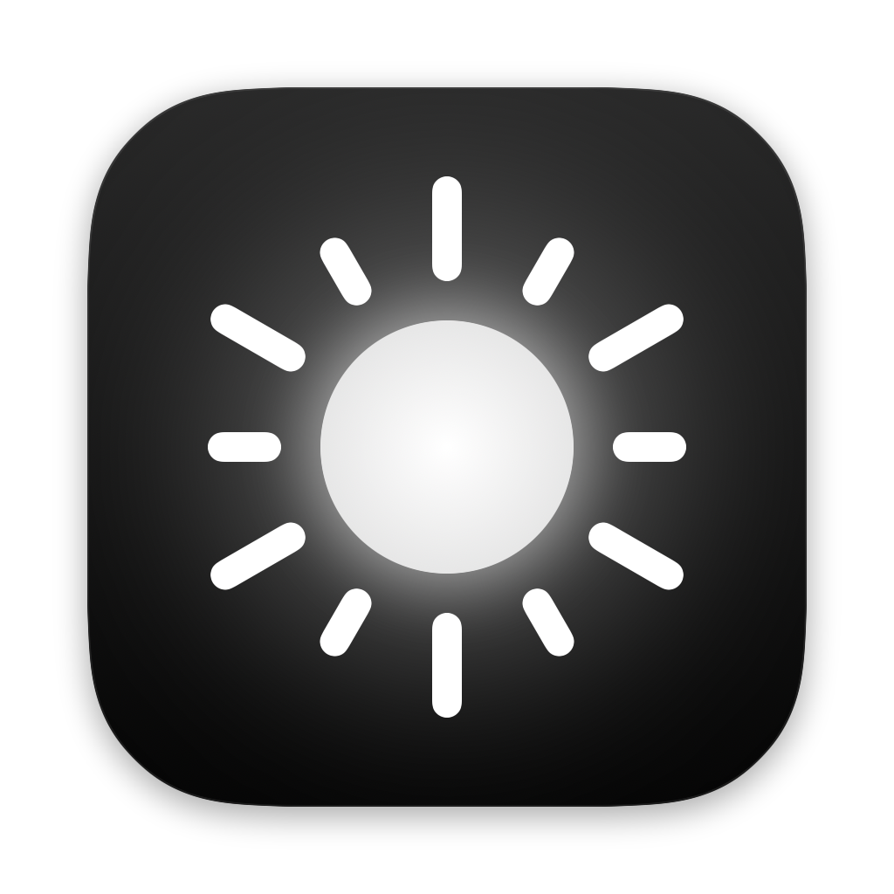

<p align="center">
  
</p>

<h1 align="center">ProDisplay</h1>

<p align="center">A minimal menu bar app that gets more out of your MacBook Pro display.</p>

## Features

- **Brighter than 100%.** On MacBook Pros with a Liquid Retina XDR display, one brightness slider goes from 0% up to 160% (adjustable), using the panel's HDR headroom for everyday content.
- **Brightness keys go further.** F1 and F2 cover the whole range, with ProDisplay's own on-screen indicator and smooth fades.
- **Volume keys.** F10, F11 and F12 control volume and mute with the same indicator.
- **Every resolution.** Pick from all the scaled sizes macOS offers, including ones System Settings hides, plus a refresh-rate picker for ProMotion.
- **External monitors.** With more than one display connected, pick a display at the top of the menu to change its resolution, HiDPI and refresh rate. A change on an external monitor asks "Keep this resolution?" and reverts after 15 seconds if you don't answer, so a mode the monitor can't show never leaves it black.
- **Custom resolutions.** Type a width under Resolution › Custom (the height follows the display's shape), choose HiDPI or not, and ProDisplay switches to it and saves it to the list. Works on external monitors and the built-in screen. On the built-in screen a custom size puts a black bar over the notch area and turns off XDR brightness while it's on.
- **Default resolution.** Hover a size (built-in or custom) and click the pin to make it that display's default. ProDisplay switches to it whenever it opens or the display reconnects. Click the pin again to clear it.
- **HiDPI switch.** Flip the current size between sharp (2 pixels per point) and low resolution (1 pixel per point).
- **Safety built in.** The brightness boost turns itself off when the Mac runs hot or the battery is low.
- **Automatic updates.** ProDisplay checks for new versions daily (via [Sparkle](https://sparkle-project.org)); you can also check right away from **Settings › Check Now**.

## Requirements

- A Mac with Apple Silicon running macOS 14 Sonoma or later
- Extended brightness needs a Liquid Retina XDR display (14″ or 16″ MacBook Pro, M1 Pro or newer). On other Macs, resolutions, HiDPI and the volume keys still work.

## Install

1. Download `ProDisplay-<version>.zip` from the [latest release](../../releases/latest) and unzip it.
2. Move **ProDisplay** to your **Applications** folder and open it.
3. macOS will say it can't verify ProDisplay, because the app isn't notarized by Apple. Click **Done**, then open **System Settings › Privacy & Security**, scroll down and click **Open Anyway** next to the ProDisplay message. You only need to do this once.
4. The welcome window walks you through allowing **Accessibility** access, which ProDisplay needs to read the brightness and volume keys. It only reacts to those keys.

ProDisplay lives in the menu bar: click the ☀︎ icon.

## Build from source

Only the Xcode Command Line Tools are needed (`xcode-select --install`).

```sh
./build.sh            # builds build/ProDisplay.app
./build.sh install    # also installs it to /Applications and launches it
./build.sh release    # also creates build/ProDisplay-<version>.zip and build/appcast.xml
```

Releases attach both files, so the update feed at `releases/latest/download/appcast.xml` always points to the newest version. The zip is signed with the maintainer's Sparkle key, so `release` only works on the maintainer's Mac.

## How it works

- **Extended brightness:** a 1×1 pt HDR pixel switches the panel into EDR mode, then the display's colour table is scaled above 1.0 so ordinary content uses the extra headroom. Everything resets when the app quits.
- **Custom resolutions:** Apple Silicon Macs only accept the modes a display reports, so ProDisplay draws the custom size on a private virtual display and mirrors the real display to it. Nothing is permanent: if ProDisplay quits, the display goes back to its normal mode (the custom size comes back on next launch).
- **Brightness and volume keys:** an event tap reads the media keys; volume goes through CoreAudio.
- ProDisplay uses some private macOS APIs (DisplayServices for brightness, CGVirtualDisplay and SkyLight for custom resolutions), so it isn't available on the Mac App Store and a future macOS update could break parts of it.

## License

[MIT](LICENSE)
